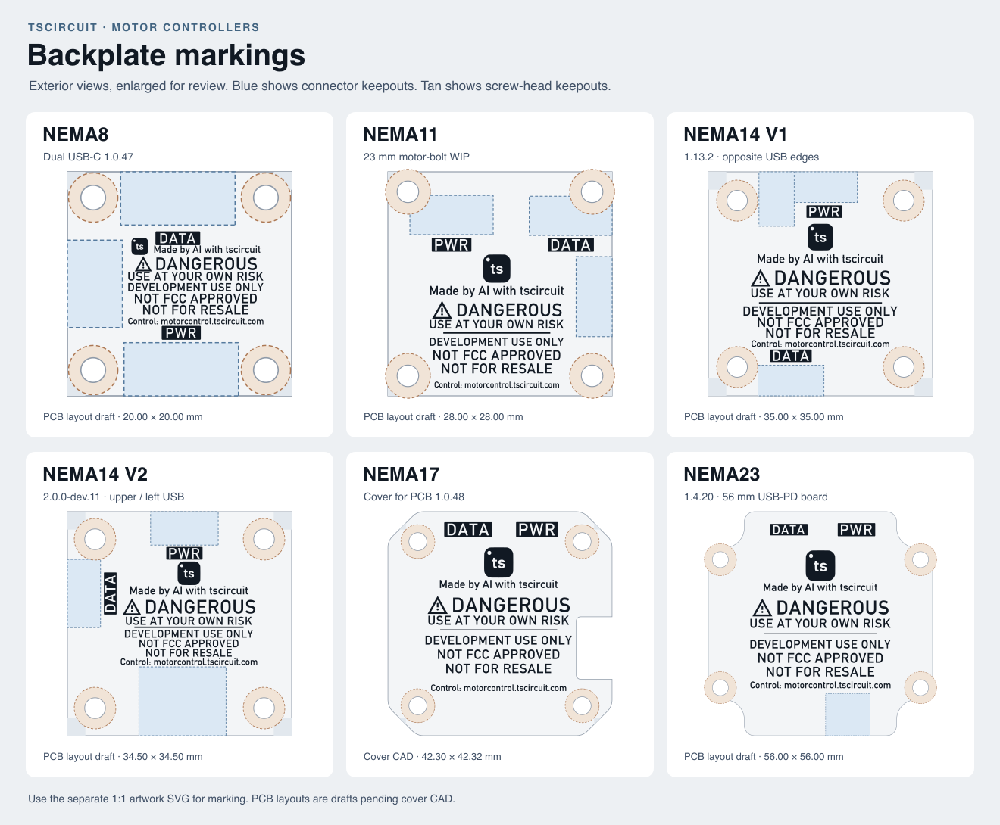

# Motor controller backplate markings

One-color, 1:1 SVG artwork for the exposed face of each controller cover. The SVG page is the full plate or reference PCB footprint in millimetres. All marks are filled vectors, including the tscircuit icon and lettering. DATA and PWR use transparent letterforms inside solid badges, and the logo has a transparent upper-left dot. Each plate shows `Control: motorcontrol.tscircuit.com`.



| Controller | Marking SVG | Fit proof | Geometry basis |
| --- | --- | --- | --- |
| NEMA8 | [Artwork](artwork/nema8.svg) | [Proof](proofs/nema8.svg) | [Shibo's four-hole dual USB-C PCB, 1.0.47](https://tscircuit.com/ShiboSoftwareDev/nema8-20mm-dual-usbc-stepper-controller?version=1.0.47). 20 × 20 mm, JST-SH at left, DATA above, PD below. |
| NEMA11 | [Artwork](artwork/nema11.svg) | [Proof](proofs/nema11.svg) | [Anas's 28 mm compact PCB at the 23 mm motor-bolt revision](https://github.com/AnasSarkiz/NEMA11_RP2040/tree/1233ccdf803a1221820f28eabf4791b4a7cfe90e). Two upright USB connectors and a right-side motor plug. |
| NEMA14 V1 | [Artwork](artwork/nema14-v1.svg) | [Proof](proofs/nema14-v1.svg) | [Anas's 35 mm V1 PCB](https://github.com/AnasSarkiz/NEMA14_RP2040/tree/b9864ad90458cb3bb6f996090dcd7ac4aeb0db5c). PD above, DATA below, JST-SH near the upper left. |
| NEMA14 V2 | [Artwork](artwork/nema14-v2.svg) | [Proof](proofs/nema14-v2.svg) | [Anas's 34.5 mm V2 PCB, 2.0.0-dev.11](https://github.com/AnasSarkiz/NEMA14_RP2040_V2/tree/d9fcd4208bf7a93743447e1a0ab2c780aa08e304). PD above, DATA at left, WAGO motor terminal below. |
| NEMA17 | [Artwork](artwork/nema17.svg) | [Proof](proofs/nema17.svg) | Existing component-side cover CAD for [imrishabh18's PCB 1.0.48](https://tscircuit.com/imrishabh18/rp2040-motor-controller?version=1.0.48). Includes the right-side motor plug notch and four Ø3.4 mm bores on 31 mm centers. |
| NEMA23 | [Artwork](artwork/nema23.svg) | [Proof](proofs/nema23.svg) | [imrishabh18's 56 mm USB-PD PCB, 1.4.20](https://tscircuit.com/imrishabh18/nema-23-stepper-controller?version=1.4.20). The PCB calls the right USB port PWR+DATA. The cover uses PWR to identify the PD input. |

## Use the files

- Use the matching file in `artwork/` at 100% scale. Align by the SVG page center. The orientation is the exterior viewed face-on, with PCB top-view left and right. For PCB bottom silkscreen, use the board tool's bottom-layer transform and check copper openings, pads, and drills against the imported artwork.
- Use `proofs/` for registration review. Blue areas reserve space for upright USB or motor connectors. Tan areas reserve screw-head clearance. The NEMA17 proof shows the modeled notch in the outline. Blue rectangles on the other variants are provisional artwork keepouts, including where a connector may pass through the face. Get actual machining contours from the cover CAD.
- The NEMA17 layout uses the existing cover geometry as the registration reference and assumes a blank marking surface. NEMA8, NEMA11, both NEMA14 revisions, and NEMA23 are PCB-based drafts. Confirm actual plate outlines, mounting hardware, connector access, and artwork legibility on a first article before production.

The supplied legend uses the requested project wording. If selling as an evaluation kit under 47 CFR § 2.803(c)(2)(iv), that provision specifies its own label wording, a kit notice, and eligible buyers. [47 CFR § 2.803](https://www.ecfr.gov/current/title-47/chapter-I/subchapter-A/part-2/subpart-I/section-2.803#p-2.803(c)(2)(iv))

## Regenerate

Edit [layouts.json](layouts.json) in millimetres from the board center, with positive Y toward the upper edge in the proof. Mount records give X, Y, drill diameter, and screw-head exclusion radius. Connector keepouts are `[minX, minY, maxX, maxY]`. A label record gives X, Y, target cap height, and an optional SVG rotation in degrees. The control line takes Y, target cap height, and an optional maximum width. The generator checks conservative bounds for every mark against the outline, four corner exclusions, screw-head envelopes, and connector keepouts.

```sh
python -m pip install fonttools 'shapely>=2,<3'
python generate.py --font '/path/to/DIN Alternate Bold.ttf'
```

The source icon is the [NEMA17 PCB's tscircuit mark](https://tscircuit.com/imrishabh18/rp2040-motor-controller/blob/assets/tscircuit-logo-bottom.svg), flipped to read on the exterior. The generated files have no font dependencies.
